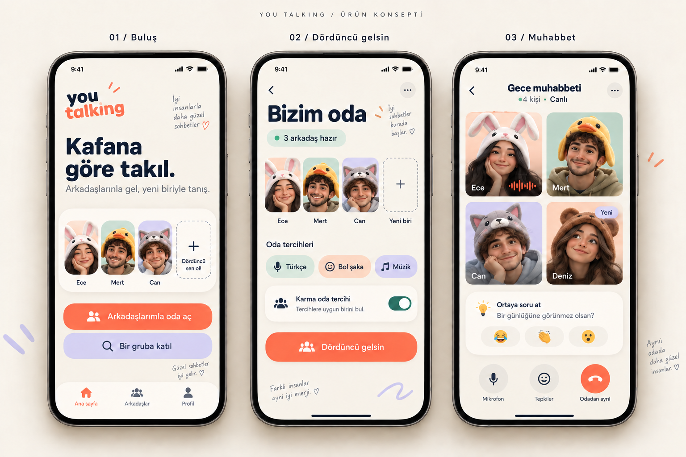

# You Talking

Arkadaşlarınla gel, yeni biriyle tanış: üç arkadaşın bir odada buluştuğu ve ortak tercihlerine uygun dördüncü bir kişiyle hayvan başlıklı avatarlarla sesli sohbet ettiği sosyal ses uygulaması için ürün, tasarım ve mimari önerisi.

> PDF ve görseller ürün önerisidir; uygulama henüz geliştirilmedi veya yayınlanmadı. iOS yayın koşulları PDF'in 23. sayfasında ele alınmıştır.

## İçerik

| Dosya | Açıklama |
| --- | --- |
| [`You_Talking_Tanitim_ve_Mimari.pdf`](You_Talking_Tanitim_ve_Mimari.pdf) | 24 sayfalık tanıtım, özellikler, dünya örnekleri ve teknik mimari belgesi |
| [`gorseller/You_Talking_Konsept.png`](gorseller/You_Talking_Konsept.png) | Üretilmiş üç ekranlı uygulama konsepti |
| [`MEMORY.md`](MEMORY.md) | Kesinleşen kullanıcı yönü, öneriler ve açık kararlar |
| [`kaynak/`](kaynak/) | PDF üretim kodu, görsel istemi ve üretim notu |



## PDF'i yeniden üretme

PDF, [ReportLab](https://www.reportlab.com/) ile Türkçe karakter destekli gömülü DejaVu Sans yazı tipleri kullanılarak üretilir.

```bash
pip install reportlab
YT_FONT_DIR=/path/to/dejavu/fonts python kaynak/build_brochure.py
```

`YT_FONT_DIR`, `DejaVuSans.ttf` ve `DejaVuSans-Bold.ttf` dosyalarını içeren klasör olmalıdır. Çıktı kök dizindeki `You_Talking_Tanitim_ve_Mimari.pdf` dosyasının üzerine yazılır.

Görselin üretim aracı: yerleşik image_gen (bkz. [`kaynak/gorsel_uretim_notu.txt`](kaynak/gorsel_uretim_notu.txt)).
